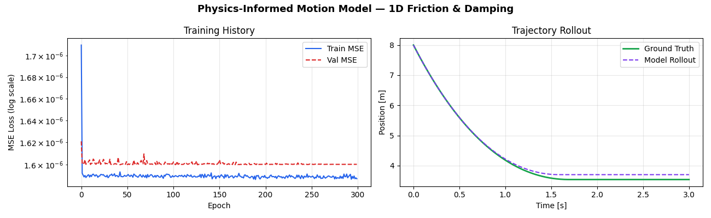
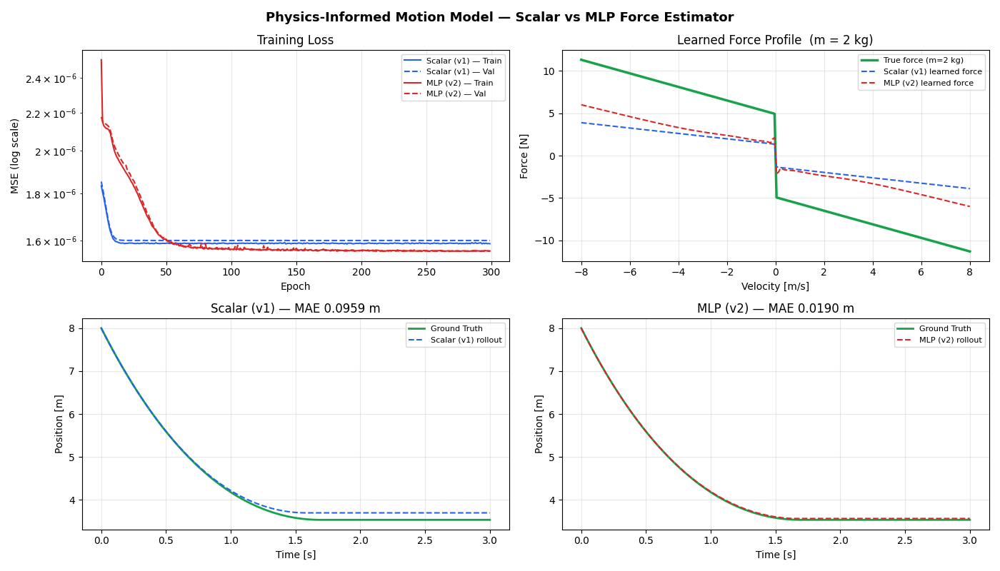
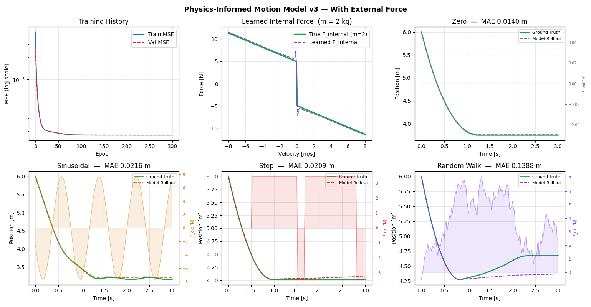
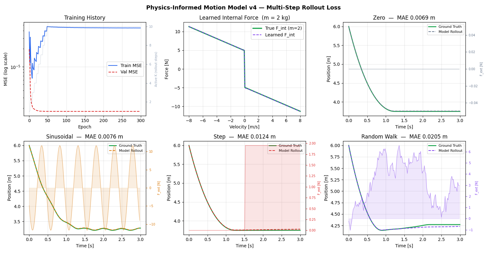
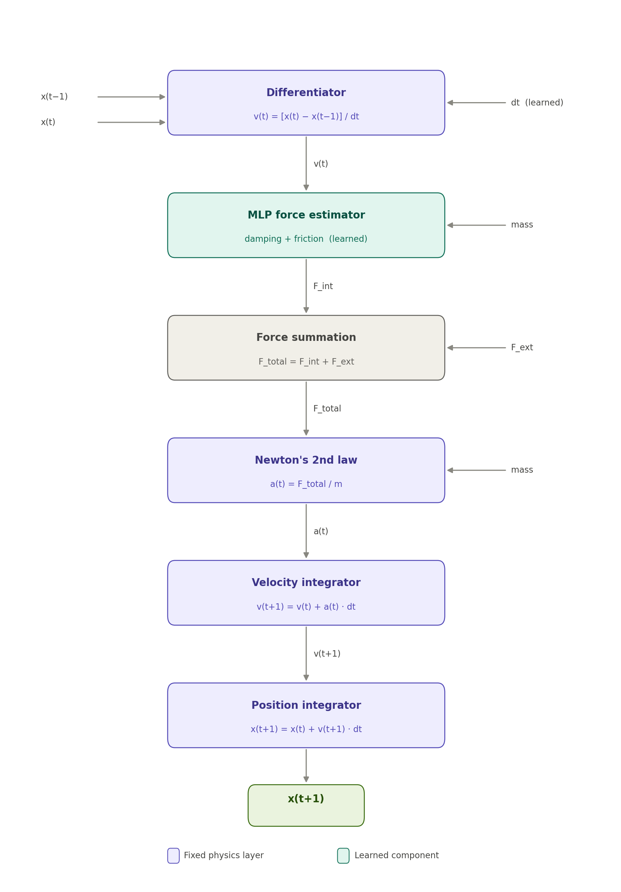
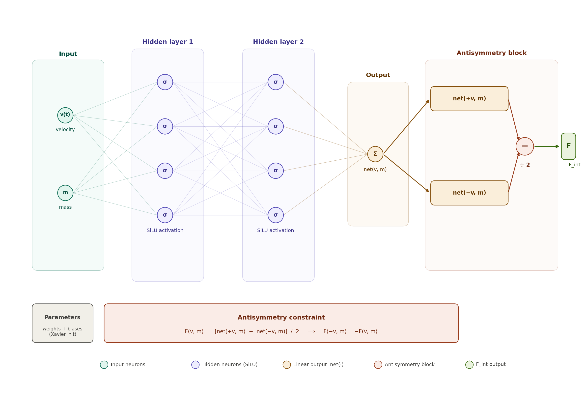

# Physics-Informed Neural Network for 1D Motion
## Project Summary

---

## Goals

The project explores a neural network architecture that learns the motion of physical objects by encoding the laws of physics directly into the model structure, rather than using a generic black-box network. The guiding principle is that **physics belongs in the architecture, not just the loss function** — interpretable, fixed operations handle kinematics, while a small learned component handles the force law.

The immediate scope is one-dimensional motion of a single mass. The design is intended to extend naturally to higher dimensions and more complex force laws.

---

## Results

The model performs well using only four features: current position, previous position, object mass, and applied external force. This model should be sufficient to act as a single axis control system. Below are the simulation results over several iterations, showing how the model evolved:

* Scalar force estimator (3 learned parameters: `b`, `c`, `ε`)



* MLP force estimator with antisymmetry; scalar vs. MLP comparison



* External force input `F_ext`; five force profile dataset



* Multi-step rollout loss with curriculum warm-up and loss weighting



In the figure above, train loss increase is a direct consequence of the curriculum warm-up, and it's actually the system behaving correctly. The key is that the training loss and validation loss are not measuring the same thing.

**Validation loss** is always computed as a plain single-step MSE — one forward pass, one error, fixed definition throughout all 300 epochs. So as the model improves, it falls steadily.

**Training loss** is a weighted multi-step rollout loss whose definition changes every epoch. The curriculum ramps $active_K$ from 1 to 10 over the first 50 epochs, and the "linear" weighting assigns progressively higher weight to later steps. So as K grows:

* more prediction steps are unrolled and summed into the loss
* later steps carry heavier weights
* each additional step compounds the model's own errors as inputs

The result is that the training loss value naturally inflates as the task gets harder, even while the model is genuinely improving at each individual step. By epoch 50 when K=10, the training loss is measuring a fundamentally harder quantity than it was at epoch 1 when K=1.

A useful analogy: imagine grading a student on progressively longer essays each week. Their writing is getting better, but the raw word-count of errors keeps rising simply because the essays are longer. The metric and the skill are moving in opposite directions.

---

## Model Architecture

The model is a chain of interpretable physics layers with a single learned component in the middle.

### Input Features
| Feature | Description |
|---|---|
| `x(t-1)` | Position at previous timestep |
| `x(t)` | Position at current timestep |
| `m` | Object mass |
| `F_ext(t)` | External applied force at current timestep |

### Forward Pass

**Model Architecture**



**MLP Architecture**



```
x(t-1), x(t)  ──► [Differentiator]      ──► v(t) = [x(t) - x(t-1)] / dt
                                                │
v(t), m        ──► [MLP: internal force] ──► F_int(t)          ← learned
                                                │
F_int + F_ext  ──► [Sum]                 ──► F_total(t)
                                                │
F_total, m     ──► [Newton layer]        ──► a(t) = F_total / m
                                                │
v(t), a(t)     ──► [Integrator]          ──► v(t+1) = v(t) + a(t)·dt
                                                │
x(t), v(t+1)   ──► [Integrator]         ──► x(t+1) = x(t) + v(t+1)·dt
```

### Fixed Physics Layers
These layers have no learned parameters. They are exact, interpretable operations:

- **Differentiator** — estimates velocity from two consecutive positions via finite difference
- **Newton layer** — divides total force by mass to produce acceleration
- **Integrator (×2)** — first-order Euler integration; one for velocity, one for position

### Learned Components

**MLP Force Estimator** — a small feedforward network that learns the internal force law (damping and friction) from data. It takes velocity and mass as inputs and outputs a scalar force.

An **antisymmetry constraint** is enforced structurally:

```
F(v, m) = [net(+v, m) - net(-v, m)] / 2
```

This guarantees `F(-v, m) = -F(v, m)` exactly for all inputs — forces reverse with velocity, as physical friction and damping must. No penalty term or regularization is needed; the constraint is baked into the forward pass.

**Learned scalar — time step `dt`** — stored as `exp(log_dt)` to stay strictly positive. Initialized away from the true value to verify convergence during training.

### Force Decomposition

| Component | Source | Learned? |
|---|---|---|
| `F_internal` | MLP(v, m) — damping + friction | Yes |
| `F_ext` | Direct input feature | No |
| `F_total` | `F_internal + F_ext` | — |

External force bypasses the MLP entirely, entering the pipeline at the summation step. This preserves the antisymmetry guarantee on the internal force, which would break if `F_ext` were fed through the network.

---

## Simulation

Synthetic training data is generated using a semi-implicit Euler integrator with the following physical forces:

- **Viscous damping**: `F_d = -b · v`
- **Kinetic friction**: `F_k = -μ_k · m · g · sign(v)`
- **Static friction**: object remains at rest once `|v| < threshold`, unless `F_ext` exceeds the static friction limit `μ_s · m · g`

### Ground Truth Parameters
| Parameter | Value |
|---|---|
| Damping coefficient `b` | 0.8 N·s/m |
| Kinetic friction `μ_k` | 0.25 |
| Static friction `μ_s` | 0.30 |
| Gravity `g` | 9.81 m/s² |
| Time step `dt` | 0.02 s |

### External Force Profiles
Five profiles are used during training to ensure the model generalizes across a range of driving conditions:

| Profile | Description |
|---|---|
| Zero | Passive decay with no external drive |
| Constant | Fixed force throughout the trajectory |
| Step | Force switches sign at random times |
| Sinusoidal | Oscillating drive at random frequency and amplitude |
| Random walk | Low-frequency noisy drive via cumulative Gaussian steps |

Trajectories are distributed evenly across profiles. Each trajectory uses a randomly sampled mass, initial position, and initial velocity.

---

## Training

### Multi-Step Rollout Loss (v4)
Rather than penalizing only the one-step prediction error, the model is trained by unrolling `K` steps autoregressively and accumulating a weighted loss at each step:

```
L = Σ_{k=1}^{K}  w_k · MSE(x_pred(t+k), x_true(t+k))
```

Predicted positions feed forward as inputs to subsequent steps, so gradients flow through the entire unrolled chain.

### Loss Weighting Modes
| Mode | Weights | Effect |
|---|---|---|
| `uniform` | All steps equal | Simple baseline |
| `linear` | Increasing with step index | Penalises long-horizon drift more |
| `exp_decay` | Decreasing exponentially (γ=0.85) | Trusts near steps more; more stable |

### Curriculum Warm-Up
Active rollout horizon `K` is ramped from 1 to `K_max` over the first `curriculum_epochs` epochs. This prevents chaotic gradients early in training when the model cannot yet make accurate single-step predictions. The consequence is that training loss initially rises as the task difficulty increases, while validation loss (always single-step MSE) falls steadily — the two metrics are measuring different things during the curriculum phase.

---

## Versioning

| Version | Key Addition |
|---|---|
| v1 | Scalar force estimator (3 learned parameters: `b`, `c`, `ε`) |
| v2 | MLP force estimator with antisymmetry; scalar vs. MLP comparison |
| v3 | External force input `F_ext`; five force profile dataset |
| v4 | Multi-step rollout loss with curriculum warm-up and loss weighting |

---

## Next Steps

The following extensions are planned in rough order of priority:

**2D motion** — extend the architecture to two spatial dimensions. This introduces two coupled differentiator-integrator chains (one per axis) sharing a single force estimator. The antisymmetry constraint generalises naturally: the force vector must reverse when the velocity vector reverses.

**Multi-step rollout loss improvements** — experiment with adaptive K scheduling, longer horizons beyond K=10, and comparing weighting modes systematically on held-out trajectories.

**Richer force laws** — the current MLP models passive dissipation only. Future work could include spring-like restoring forces, position-dependent forces, and contact/collision events.

**Uncertainty quantification** — replacing the point-estimate MLP with a probabilistic estimator (e.g., ensemble or dropout-based) to produce confidence intervals on predicted trajectories.

**Real data** — once the synthetic pipeline is validated, apply the architecture to real sensor recordings where the true force law is unknown and must be discovered entirely from data.
